<div align="center">


# M I.A. Shared View

**Sua tela na TV. Sem cabos. Sem nuvem.**

Compartilhamento de tela com áudio, pareamento seguro e ferramentas de apresentação ao vivo — do Windows para Smart TVs Samsung, Android TV, Google TV e Fire TV, direto pela rede local.

Projeto autoral de **Marcio Lourenço** · [M I.A. Solutions](#autor) · Licença [MIT](LICENSE)

</div>

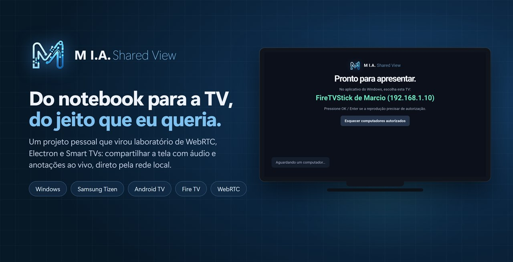

> [!WARNING]
> **Use por sua conta e risco.** Este é um projeto pessoal, fornecido "como está", sem garantia de qualquer tipo (veja a [licença](LICENSE)). A instalação nas TVs usa o **modo desenvolvedor** e apps fora das lojas oficiais. O projeto não tem vínculo com Samsung, Amazon ou Google. Foi testado apenas nos aparelhos listados em [Modelos testados](#modelos-testados); outros modelos e versões do sistema podem se comportar de forma diferente.

## Por que existe

A reunião começa e a apresentação não aparece na TV: falta o cabo, o adaptador sumiu, o espelhamento nativo trava ou fica sem som — e, na hora de explicar um número, não há como apontar, circular ou dar zoom.

O **M I.A. Shared View** transforma qualquer Smart TV compatível em uma tela de apresentação sem fio. Você escolhe a TV numa lista, aprova uma única vez no controle remoto e transmite a tela inteira ou só uma janela — PowerPoint, Excel, navegador — com áudio. Tudo ponto a ponto, na rede local.

## Recursos

- **Tela inteira ou uma janela**, com seletor de miniaturas e **áudio do sistema**.
- **Pareamento seguro**: lista de TVs na rede, aprovação no controle remoto e autorização lembrada (token exclusivo por TV). Uma TV em uso não aceita outro computador.
- **Descoberta automática, sem IP na TV**: a TV procura sozinha os computadores com o app aberto e fica disponível para todos ao mesmo tempo — um apresenta por vez, nos outros ela aparece "em uso". Os receptores Android também ouvem o anúncio UDP do app Windows.
- **Ferramentas de apresentação sobre qualquer app**: apontador, caneta, marca-texto, caneta laser, formas, borracha, desfazer, lupa, holofote, zoom por seleção, quadro branco/preto e congelar imagem — com 6 cores e 3 espessuras.
- **Caixa flutuante** sempre visível sobre os apps (e invisível na TV), com controles da TV e cronômetro.
- **Qualidade adaptativa**: H.264 por hardware; aparelhos que decodificam 1080p devagar pedem 720p automaticamente.
- **Apresentação de imagens** (PNG/JPEG/WebP) com as setas do teclado, tela preta, silenciar e renomear a TV pelo painel.
- **Privacidade**: sem servidor na nuvem, sem STUN/TURN — os dados não saem da rede local.

| Anotações ao vivo | Caixa de ferramentas |
|---|---|
| 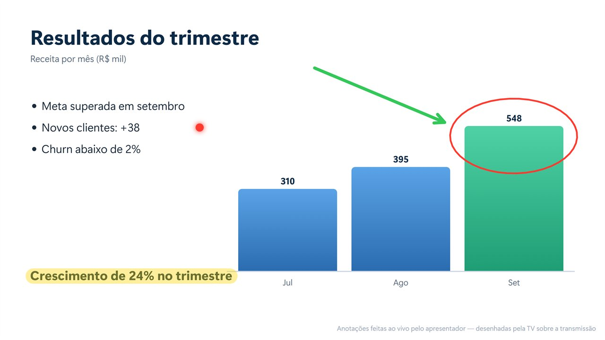 | 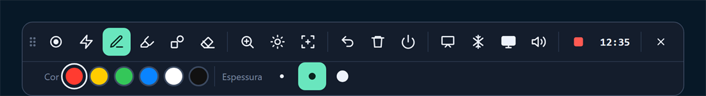 |
| **Holofote** | **Lupa** |
| 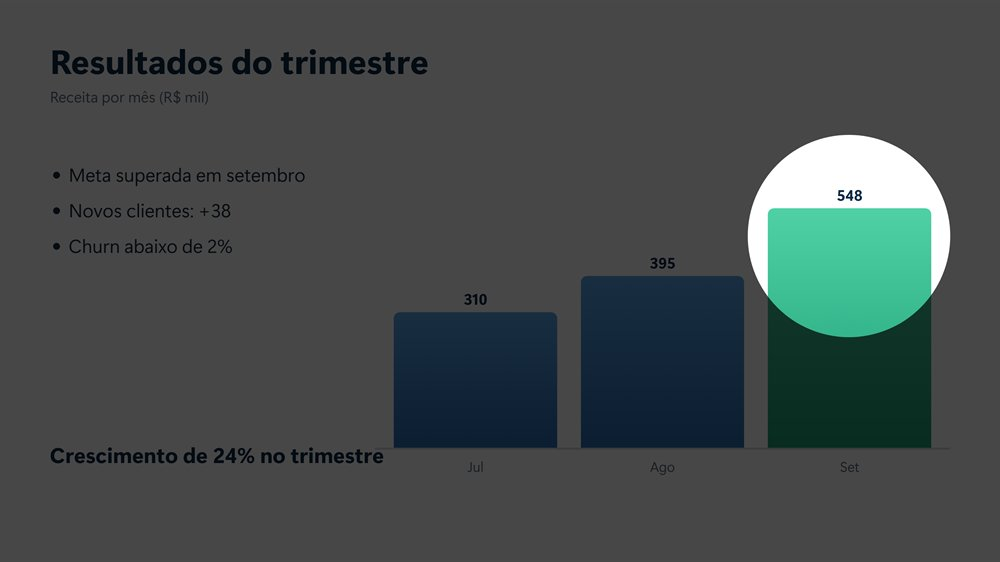 | 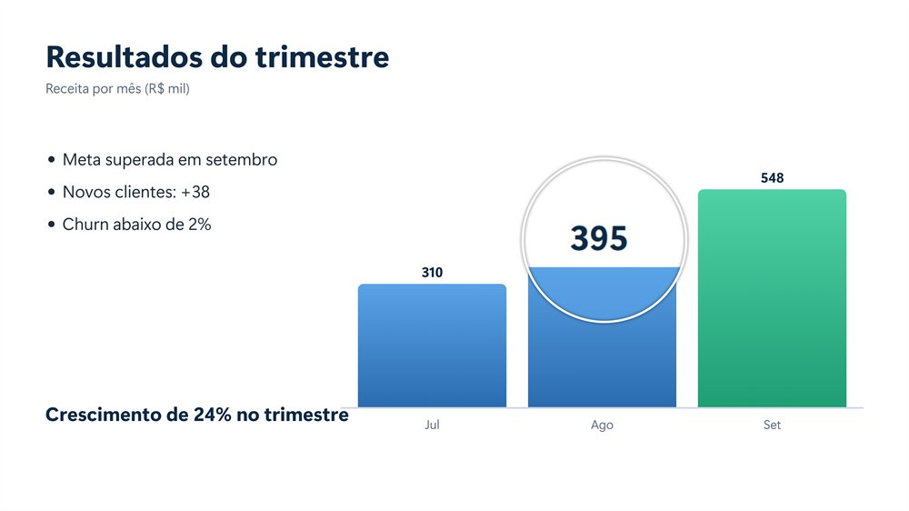 |
| **Escolha o que compartilhar** | **Autorização na TV** |
| 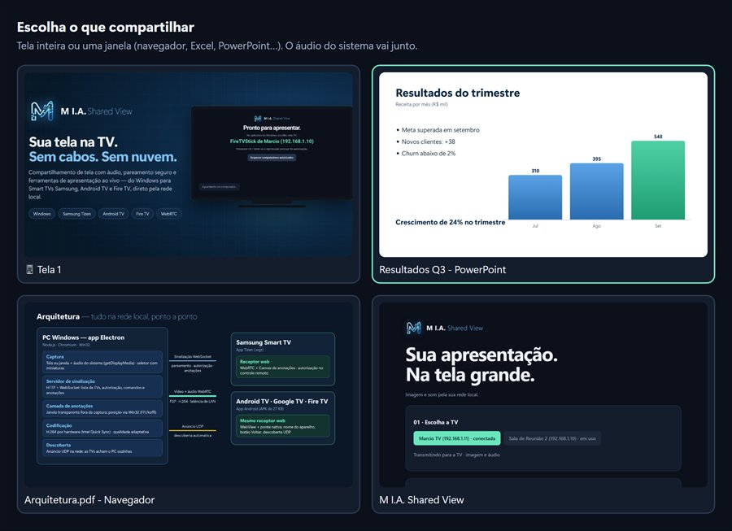 | 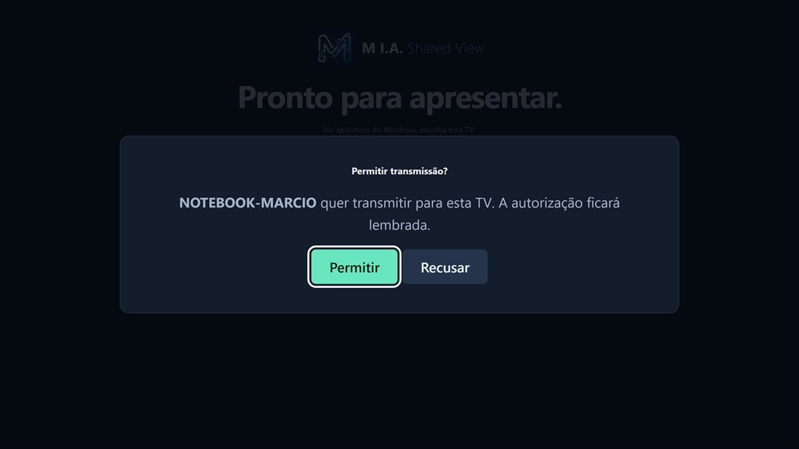 |

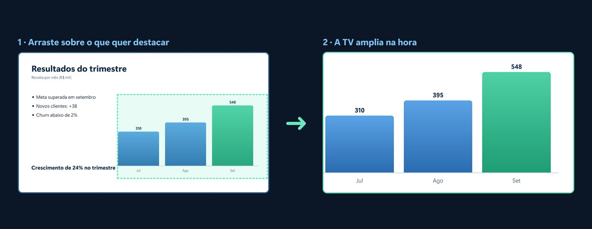

## Plataformas

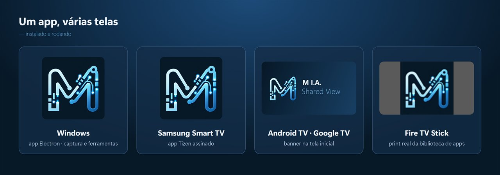

| Parte | Tecnologia | Requisito mínimo |
|---|---|---|
| Transmissor (Windows) | Electron + Node.js | Windows 10/11 |
| Receptor Samsung | App web Tizen (`.wgt`) | Tizen 5.5 (declarado em `tv/config.xml`) |
| Receptor Android | App Android (APK) | Android 5.1 (API 22) |
| Receptor LG | App web webOS (`.ipk`) | webOS TV (testado no 8.3) |

### Modelos testados

| Aparelho | Sistema | Resultado |
|---|---|---|
| Samsung **UN70DU8000GXZD** (série DU8000, 2024) | **Tizen 9.0** | ✅ instalação via Tizen Studio/linha de comando, imagem, áudio, anotações e autorização |
| Samsung **LH55BEFH4GGXZD** (Business TV, série BEF) | **Tizen 9.0** | ✅ instalação via linha de comando, descoberta por varredura e conexão com vários computadores · acesso remoto da Samsung (porta 8002) bloqueado pelo aparelho |
| LG **50UR871C0SA** (série UR871C, 2023) | **webOS 8.3** | ✅ instalação via webOS CLI, descoberta por varredura e conexão · transmissão: em validação |
| Amazon **Fire TV Stick** (modelo AFTSS) | **Fire OS 7 / Android 9** (API 28) | ✅ imagem, áudio e anotações; 720p automático |
| PC com **Windows 11** | — | ✅ transmissor, ferramentas e instalador |

A versão do Tizen depende do ano do modelo e das atualizações de firmware da Samsung (a TV testada, de 2024, já estava no Tizen 9.0). O receptor usa WebRTC e recursos do navegador interno da TV, que variam entre versões — **modelos e versões não listados não foram testados**. Relatos de outros aparelhos são bem-vindos nas *issues*.

O receptor é o **mesmo código web** (`public/app.js`, `public/ink.js`) em todas as plataformas de TV.

## Como funciona

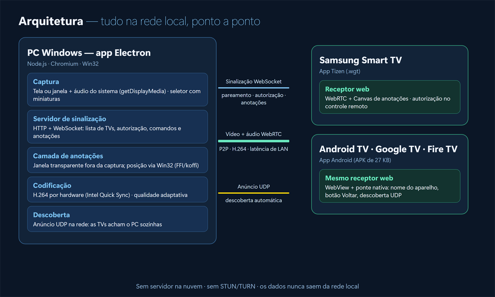

- **Sinalização** por WebSocket (`server.js`): lista de TVs, autorização, comandos e anotações.
- **Mídia** por WebRTC ponto a ponto, preferindo H.264. Os candidatos ICE mDNS (`*.local`) das TVs são reescritos com o IP real pelo servidor, para conectar sem STUN/TURN.
- **Anotações**: uma janela transparente no Windows, excluída da captura (`setContentProtection`), recebe os traços; a posição da janela compartilhada vem da API Win32 via [koffi](https://koffi.dev). Os traços trafegam em coordenadas normalizadas e a TV os redesenha por cima do vídeo.
- **Descoberta**: a TV não pode abrir portas na rede, então é ela quem procura. A cada 30 s ela varre as sub-redes /24 que já conhece (a dela, a dos computadores já vistos e o `data-server` gravado na instalação) e as faixas cadastradas uma vez (`data-ranges` na instalação ou o campo "Faixa de rede dos computadores" na tela da TV), chamando `http://IP:8787/ping`. Ela se conecta a **todos** os computadores encontrados; a conexão ativa é a do que pediu acesso, e os demais recebem `presence` para mostrar a TV em uso. Os receptores Android também ouvem o anúncio UDP na porta 8788.
- **Busca no painel** ("Buscar TV por IP ou faixa"): lista as TVs Samsung pela API da porta 8001 e, se a TV permitir o acesso de dispositivos externos (porta 8002), abre o receptor nela já apontando para o computador.

## Instalação

Requer [Node.js](https://nodejs.org) 20+ e npm.

> [!IMPORTANT]
> Instalar o receptor nas TVs envolve ativar o **modo desenvolvedor** e instalar apps **fora das lojas oficiais**. Faça isso **por sua conta e risco**, apenas em aparelhos seus ou que você tenha autorização para configurar. Leia [Aviso legal e responsabilidade](#aviso-legal-e-responsabilidade) antes de continuar.

```bash
git clone https://github.com/marcioldp777/M_IA_Shared_View.git
cd M_IA_Shared_View
npm install
npm test
```

### 1. Windows

```bash
npm run build:windows      # gera em dist/ o instalador (Setup) e o portátil
npm run build:installer    # só o instalador
```

Execute `dist/M I.A. Shared View Setup 1.0.0.exe` para instalar (permite escolher a pasta e cria atalhos na Área de Trabalho e no Menu Iniciar) ou use o portátil `dist/M I.A. Shared View Portable 1.0.0.exe`, que roda sem instalar. O app sobe o servidor na porta **TCP 8787**; permita o acesso na **rede privada** quando o Windows perguntar. Para desenvolver sem empacotar: `npm run desktop`.

### 2. Receptor Android (Fire TV, Android TV, Google TV, TV Box)

> Ativar a depuração ADB e permitir apps de origem desconhecida reduz proteções do aparelho. Desative-as depois da instalação, se preferir.

```bash
npm run build:android      # gera dist/SalaTV-android.apk (usa o Android SDK e o JDK do Android Studio)
```

- **Fire TV**: Configurações → Minha Fire TV → Opções do desenvolvedor → ative *Depuração ADB* e *Apps de origem desconhecida*. Depois:
  ```bash
  adb connect IP-DA-TV
  adb install -r dist/SalaTV-android.apk
  ```
  Ou baixe o APK pelo app *Downloader*.
- **Android TV / Google TV / TV Box**: ative as Opções do desenvolvedor (7 cliques em *Build*), ligue a depuração e use os mesmos comandos, ou instale por pendrive.

O app encontra o computador sozinho na rede.

### 3. Receptor Samsung (Tizen)

> Testado nas Samsung **UN70DU8000GXZD** e **LH55BEFH4GGXZD**, ambas com **Tizen 9.0**. Em outros modelos e versões do Tizen a instalação ou o funcionamento podem ser diferentes. Use por sua conta e risco.

> **Particularidade da Samsung:** diferente do Android, uma TV Samsung só instala apps próprios assinados com certificados emitidos pela Samsung. É preciso ter uma **conta Samsung**, gerar no Tizen Studio (Certificate Manager) um **certificado de autor** e um **certificado de distribuidor**, e incluir neste último o **DUID** (identificador único) de cada TV. Cada TV nova precisa entrar no certificado e o app precisa ser assinado de novo.

**Antes (uma vez):** instale o [Tizen Studio](https://developer.samsung.com/smarttv/develop/getting-started/setting-up-sdk/installing-tv-sdk.html) com a extensão *Samsung Certificate* e crie, no **Certificate Manager**, um perfil Samsung (autor + distribuidor) que inclua o DUID da sua TV ([guia oficial](https://developer.samsung.com/smarttv/develop/getting-started/using-sdk/tv-device.html)).

**Instalação pela linha de comando do Tizen:**

1. Em `tv/index.html`, preencha `data-server` com o endereço de um computador (ex.: `http://192.168.0.10:8787`) e, se os computadores ficam em outras sub-redes, `data-ranges` com as faixas (ex.: `192.168.10.0/24, 192.168.20.0/24`). Isso só dá à TV os pontos de partida da busca: depois ela acha sozinha qualquer computador nessas redes. As faixas também podem ser digitadas uma vez na tela da TV.
2. Empacote, instale e abra:
   ```bash
   npm run prepare:tv
   tizen package -t wgt -s SEU_PERFIL -- tv
   tizen install -n "M I.A. Shared View.wgt" -s IP-DA-TV:26101 -- tv
   tizen run -p SalaTV0001.Sala -s IP-DA-TV:26101
   ```

> Não versione certificados, perfis ou senhas (`*.p12`, `profiles.xml` já estão no `.gitignore`).

### 4. Receptor LG (webOS)

> Testado apenas na LG **50UR871C0SA** com **webOS 8.3**. Use por sua conta e risco.

**Antes (uma vez):** crie uma conta gratuita em [webOS TV Developer](https://webostv.developer.lge.com), instale na TV o app **Developer Mode** (LG Content Store), entre com a conta, ligue **Dev Mode Status** (a TV reinicia) e depois **Key Server**. Instale a CLI: `npm install -g @webos-tools/cli`.

```bash
npm run prepare:tv                       # copia o receptor para webos/
ares-setup-device --add lgtv -i "{\"host\":\"IP-DA-TV\",\"port\":9922,\"username\":\"prisoner\"}"
ares-novacom --device lgtv --getkey      # pede a passphrase mostrada no Developer Mode
ares-setup-device --modify lgtv -i "{\"privatekey\":\"lgtv_webos\",\"passphrase\":\"PASSPHRASE\"}"
ares-package webos -o dist               # ajuste data-server/data-ranges em webos/index.html antes, como na Samsung
ares-install --device lgtv dist/com.mia.sharedview_1.2.0_all.ipk
ares-launch --device lgtv com.mia.sharedview
```

> **Particularidade da LG:** a sessão do modo desenvolvedor expira em **50 horas** e, ao expirar, a LG remove o app. Renove pelo botão **Extend** no Developer Mode ou com `ares-extend-dev --device lgtv`.

## Uso

1. Abra o receptor na TV — ela mostra **"Pronto para apresentar"** e o nome da TV.
2. No app Windows, clique na TV em **"01 · Escolha a TV"**.
3. Na primeira vez, aprove com **Permitir** no controle remoto. Depois disso, a TV lembra do computador.
4. Clique em **Compartilhar tela ou aplicação** e escolha a tela ou a janela.
5. Use as ferramentas pelo painel, pela **caixa flutuante** ou pelos atalhos.

<p align="center">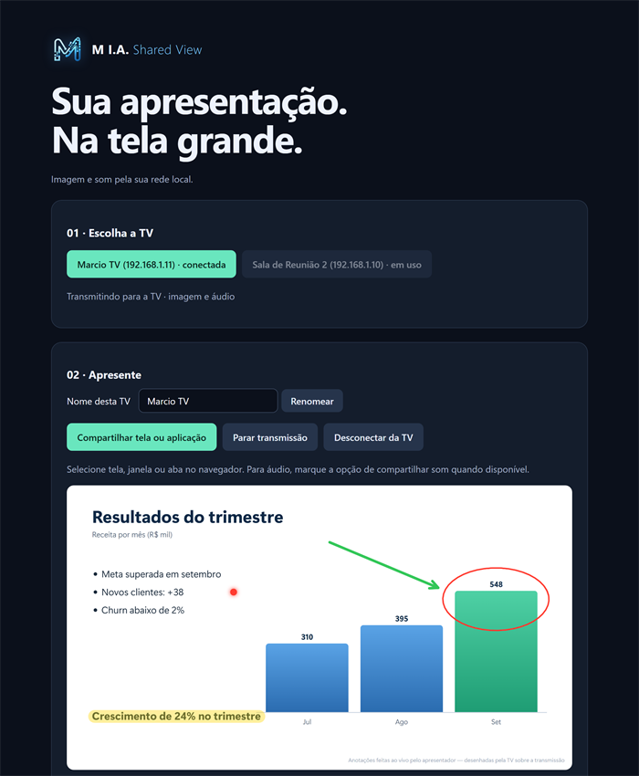</p>

Na TV: **OK** autoriza a reprodução se necessário; **Voltar duas vezes** sai do app; **"Esquecer computadores autorizados"** revoga as autorizações.

### Atalhos (funcionam com o foco em qualquer app)

| Atalho | Ação | Atalho | Ação |
|---|---|---|---|
| `Ctrl+Alt+1` | Apontador | `Ctrl+Alt+6` | Caneta laser |
| `Ctrl+Alt+2` | Caneta | `Ctrl+Alt+7` | Formas |
| `Ctrl+Alt+3` | Marca-texto | `Ctrl+Alt+8` | Borracha |
| `Ctrl+Alt+4` | Lupa | `Ctrl+Alt+9` | Holofote |
| `Ctrl+Alt+5` | Zoom por seleção | `Ctrl+Alt+Z` | Desfazer |
| `Ctrl+Alt+0` | Limpar | `Esc` | Desliga tudo e sai do zoom |

## Solução de problemas

- **A TV não aparece / não conecta**: confirme que PC e TV estão na mesma rede, que a rede do Windows está como **Privada** e que o firewall permite o app na porta 8787. Redes com *isolamento de clientes* (comum em Wi-Fi de visitantes) bloqueiam a conexão.
- **Imagem chega, mas sem som**: alguns antivírus corporativos bloqueiam a captura de áudio de apps desconhecidos — marque o app como confiável. Sem áudio, o app transmite só a imagem e também tenta usar *Mixagem estéreo* ou VB-Cable, se existirem.
- **Fluidez**: para registrar estatísticas de vídeo (resolução, quadros/s, decodificação, buffer) a cada 5 s, abra o app com `SALA_DIAGNOSTICO=1`. O log fica em `%APPDATA%\samsung_compartilhamento_tela\sala-tv.log`.

## Desenvolvimento

| Comando | O que faz |
|---|---|
| `npm start` | Servidor e páginas sem Electron (porta 8787) |
| `npm run desktop` | App Windows em modo desenvolvimento |
| `npm test` | Testes (`node:test`): servidor, receptor e renderizador de anotações |
| `npm run prepare:tv` | Copia o receptor para `tv/` (Samsung), `webos/` (LG) e os assets do Android |
| `npm run build:windows` | Instalador e executável portátil do Windows (electron-builder) |
| `npm run build:installer` | Só o instalador do Windows |
| `npm run build:android` | APK Android |

Estrutura: `server.js` (sinalização), `desktop.js` / `tools.js` (Electron, ferramentas, caixa flutuante), `discovery.js` (busca de TVs Samsung por IP/faixa), `public/` (painel, receptor, anotações), `tv/` (Tizen), `webos/` (LG), `android/` (app Android).

## Segurança e limites

- Feito para **redes confiáveis**: a sinalização usa HTTP/WebSocket sem criptografia. Não exponha a porta 8787 na internet.
- Cada computador precisa ser aprovado na TV; a TV aceita um computador por vez.
- Sem suporte a conteúdo com DRM nem a transmissão pela internet.

## Aviso legal e responsabilidade

- O software é fornecido **"como está"**, sem garantias de qualquer tipo, conforme a [licença MIT](LICENSE). O autor não se responsabiliza por danos, perda de dados, mau funcionamento, perda de garantia ou qualquer outro problema decorrente da instalação ou do uso.
- **A instalação é de responsabilidade de quem a realiza**: ativar o modo desenvolvedor, gerar certificados e instalar apps fora das lojas oficiais são procedimentos feitos por sua conta e risco. Consulte os termos do fabricante do seu aparelho e da plataforma de desenvolvedor (ex.: Samsung) antes de prosseguir.
- Use somente em aparelhos e redes que sejam seus ou para os quais você tenha autorização. Em ambiente corporativo, siga as políticas de TI e segurança da empresa.
- Os certificados Samsung são **pessoais**: não compartilhe seus arquivos `.p12` nem senhas, e não os inclua em repositórios.
- Os testes foram feitos apenas nos aparelhos listados em [Modelos testados](#modelos-testados).
- Samsung, Tizen, Amazon, Fire TV, Android e Google TV são marcas de seus respectivos donos. Este é um projeto independente, **sem vínculo, patrocínio ou endosso** dessas empresas.

## Autor

Idealizado e desenvolvido por **Marcio Lourenço** — **M I.A. Solutions**.

Contribuições são bem-vindas: abra uma *issue* ou um *pull request*.

## Licença

[MIT](LICENSE) © 2026 Marcio Lourenço
